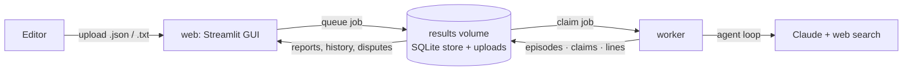
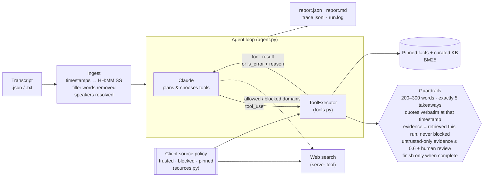
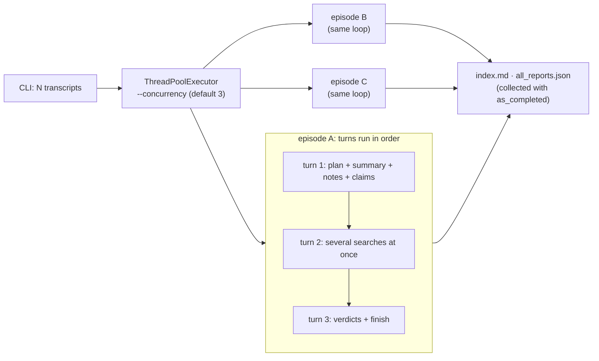
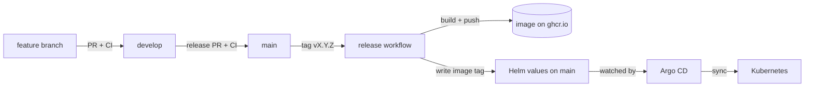

# Podcast Agent — summarise, extract show notes, fact-check

An agentic system that turns raw podcast transcripts into publish-ready show notes and a
fact-check report for an ad agency's content team. Built on Claude (`claude-opus-5-5`) with a
plain-Python tool loop — no agent framework — so every step is easy to read and change.

Claims are verified with **live web search steered by a per-client source policy**: each agency
client agrees which domains it trusts, which it blocks, and a few pinned facts of its own. A
curated local knowledge base keeps the agent working offline and in tests.

| Deliverable | Where |
|---|---|
| Source code (containerised) | [`src/podcast_agent/`](src/podcast_agent), [`Dockerfile`](Dockerfile), [`docker-compose.yml`](docker-compose.yml) |
| Sample outputs (JSON + Markdown) | [`examples/sample_run/`](examples/sample_run) — start at [`index.md`](examples/sample_run/index.md) |
| Agent reasoning logs | [`examples/sample_run/run.log`](examples/sample_run/run.log) and per-episode `trace.jsonl` |
| Deployment strategy (diagram + narrative): beta on one machine today; long term, Kubernetes on any cloud, plus an AWS managed variant | [`docs/DEPLOYMENT.md`](docs/DEPLOYMENT.md) |
| Roadmap: single sign-on, MCP server, Kubernetes, next steps | [`docs/ROADMAP.md`](docs/ROADMAP.md) |
| Client source policies | [`data/clients/`](data/clients) |
| Review GUI (upload, job status, report review and sign-off, history, disputes) | [`gui.py`](src/podcast_agent/gui.py) · `docker compose up web worker` → http://localhost:8501 |
| Golden set, regression report, CI, Helm chart | [`data/golden/`](data/golden), [`.github/workflows/`](.github/workflows), [`deploy/`](deploy), [`CHANGELOG.md`](CHANGELOG.md) |

---

## Quick start

### With Docker (recommended)

```bash
cp .env.example .env          # then put your ANTHROPIC_API_KEY in .env
docker compose run --rm agent # processes every file in data/transcripts
```

One Anthropic API key covers both Claude and web search; no other key is needed. Reports appear
in `./output/`. Other commands:

```bash
docker compose run --rm agent run data/transcripts/ep002_ai_healthcare.json -v   # one episode
docker compose run --rm agent run --client example_healthtech                   # another client's policy
docker compose run --rm agent run --no-web-search                               # offline: pinned facts + local KB
docker compose run --rm agent sources --client example_healthtech               # show a client's policy
docker compose run --rm agent kb-search "FDA autonomous AI"                     # query the local KB
docker compose --profile test run --rm tests                                    # unit + GUI tests (no API key needed)
```

### Review GUI

```bash
docker compose up web worker   # GUI on http://localhost:8501; the worker runs the jobs
```



| Page | What it does |
|---|---|
| **Upload** | Drop in transcripts, choose the client source policy and web search on/off; a file that can't be parsed is rejected on the spot |
| **Jobs** | Live status of every run (refreshes every 3 s): the agent's latest step, time and cost |
| **Report review** | Summary, takeaways, quotes, tags and the fact-check table on the left; the transcript on the right, **raw and clean side by side** with the words cleaning removed struck through. **↪ Show line** jumps from any quote or claim to its line. A claim flagged 🔎 for human review gets **✔ Mark reviewed**: the reviewer and time are saved and it leaves the "Needs review" count |
| **History** | Full-text search over episodes, quotes, claims and transcript lines; filter claims by verdict; release and prompt version per episode |
| **Disputes** | Flag a verdict or quote with a note, then resolve or reopen it; disputes stay with the episode across reruns |

The GUI holds no API key and never calls Claude; only the worker does. CLI runs are saved to the same
store, so they show up in History too. Deep link to a report: `http://localhost:8501/?page=Report%20review&episode=ep002`.

### Without Docker (Python 3.11+)

```bash
python -m venv .venv
source .venv/bin/activate          # Windows: .venv\Scripts\activate
pip install -e ".[dev,gui]"
python -m podcast_agent run        # same CLI as above
python -m podcast_agent gui        # review GUI on http://localhost:8501 …
python -m podcast_agent worker     # … and, in a second terminal, the worker that runs uploaded jobs
python -m podcast_agent eval output --baseline examples/sample_run   # golden-set regression report
pytest -q
```

### CLI options

| Flag | Default | Purpose |
|---|---|---|
| `inputs…` | `data/transcripts` | Transcript files or folders (`.json` or `.txt`) |
| `--client` | `default` | Source policy: an id under `data/clients/` or a path to a JSON file |
| `--web-search` / `--no-web-search` | on | Live web search; `--no-web-search` is offline mode (pinned facts + local KB only) |
| `--out` | `output` | Output folder |
| `--model` | `claude-opus-5-5` | Any Claude model id |
| `--effort` | `medium` | `low` … `max` reasoning effort |
| `--concurrency` | `3` | Episodes processed in parallel |
| `--max-steps` | `25` | Model turns per episode before giving up |
| `--otel` | off | Optional: send OpenTelemetry traces and metrics (see [Optional observability](#optional-observability-scaffolding)) |
| `-v` | off | Debug logging |

Every option can also be set in `.env` (see [`.env.example`](.env.example)).

---

## How it works



**The model decides how to do the work; code decides what counts as done.**

1. **Plan.** The agent's first call is `create_plan`; the plan is logged and saved in the report.
2. **Act.** Claude calls tools to submit the summary and key notes, register check-worthy
   claims, search for evidence (several searches in one turn when it can), and record a verdict
   per claim. It picks the order and the search queries itself.
3. **Validate.** Each tool checks its input. A failed check goes back to Claude as an
   `is_error` result with the reason (e.g. *"quote at 00:02:45 is not verbatim. The line reads: …"*),
   and Claude corrects itself and resubmits.
4. **Finish.** `finish` is rejected until every deliverable exists and every claim has a verdict.
   If the step budget runs out, the report is still written, marked `incomplete`, with what is missing.

### Tools

| Tool | What it does | Guardrail |
|---|---|---|
| `create_plan` | Records the agent's plan | Must have steps |
| `submit_summary` | Summary + themes / discussions / outcomes | 200–300 words; ≥ 2 themes |
| `submit_key_notes` | 5 takeaways, 2–5 quotes, 3–8 tags | Each quote must appear **verbatim** in the line at its timestamp, by that speaker; tags normalised to `kebab-case` |
| `register_claims` | Lists check-worthy claims, assigns ids | Timestamp must exist; speaker taken from the transcript |
| `search_knowledge_base` | BM25 over the client's pinned facts and the curated KB | Every returned source joins the provenance whitelist, with its tier |
| `web_search` | Anthropic server tool, sent the client's allow list or block list | Blocked-domain results are dropped in code and can never be cited |
| `record_verdict` | Verdict + confidence + rationale + evidence + review flag | Evidence must come from **this run's** searches; `verified` needs ≥ 1 source; no-evidence verdicts ≤ 0.7; untrusted-only evidence ≤ 0.6 and flagged for review |
| `finish` | Reviewer notes for the human editor | Blocked until everything is complete |

---

## Trusted sources: a per-client source policy

A knowledge base of stored facts goes stale, and in this demo its entries were written from the
model's own knowledge, so it is hard to defend as evidence. In real use **the agency decides which
sources it trusts**, and that is agreed with each client up front. So the KB became a policy:

```json
// data/clients/<client>.json (abridged)
{
  "client_id": "example_healthtech",
  "search_mode": "trusted_only",                 // or "prefer_trusted"
  "trusted_domains": [{"domain": "fda.gov", "topics": ["medical", "regulation"]}, …],
  "blocked_domains": [{"domain": "reddit.com", "reason": "user-generated"}, …],
  "pinned_facts":   [{"id": "pin-northwind-triage-status", "content": "…", "as_of": "2026-09"}]
}
```

| Evidence tier | Where it comes from | Effect |
|---|---|---|
| 📌 `pinned` | Client-supplied fact, not on the public web (e.g. its own product claims) | Trusted; checked first for client-specific claims |
| 📚 `reference` | Curated local KB ([`data/knowledge_base.json`](data/knowledge_base.json)) | Trusted; the offline/test stand-in for the agreed source list |
| 🛡️ `trusted_web` | Live result on a trusted domain (subdomains count) | Trusted; full confidence |
| 🌐 `other_web` | Live result anywhere else | If it is the only support: confidence ≤ 0.6 and **flagged for human review** |
| ⛔ blocked | Live result on a blocked domain | Never enters the whitelist, so it can never be cited |

- **`prefer_trusted`** sends the API's `blocked_domains` list and searches the open web; **`trusted_only`**
  sends `allowed_domains`. The API takes one list or the other, never both, so blocked domains are
  also enforced in code either way.
- **Conflicts go to a person.** When a pinned fact and a live result disagree, the agent sets
  `needs_human_review` with a reason; code requires the reason.
- **The agent never edits its own sources.** A transcript is untrusted input and could try to talk
  the model into trusting a domain. Policies change only through an admin path outside the run, and
  each report records the policy version (a hash) it was produced under.
- `python -m podcast_agent sources --client <id>` prints a policy and the exact web-search tool
  configuration sent to the API.

### Fact-check verdicts

| Verdict | Meaning |
|---|---|
| ✅ Verified true | A retrieved source supports the claim |
| ⚠️ Possibly outdated/inaccurate | A retrieved source contradicts it, dates it, or shows it overstates the facts |
| ❓ Unverifiable | Nothing retrieved addresses it, or it is a prediction, anecdote, or too vague to test |

**Confidence** is the agent's confidence in its *verdict* given the evidence (high when a trusted
source directly settles it; ~0.3–0.6 for unverifiable claims). The agent is given today's date so it
can flag claims that have aged (e.g. ep001's "predictions for 2025").

---

## What runs in parallel



- **Across episodes:** threads, because the work is almost all waiting on the network (Claude and
  search). Three ~45 s episodes finish in roughly the time of the slowest one instead of the sum.
  Results are collected with `as_completed`; one failed episode is logged and never stops the others.
- **Within one episode:** Claude batches independent tool calls in one turn (several searches, many
  verdicts), and all results go back in one message.
- **What stays sequential:** the turns of one episode, because each depends on the last.
- **Why not asyncio (yet):** measured on ep003, the agent spent 35.9 s waiting on Claude and 0.14 s in its
  own tools. Threads overlap that waiting with ordinary, readable functions. Next steps are more worker
  pods on Kubernetes pulling from a queue (KEDA scales on queue depth), with a shared rate limiter sized to
  the model quota; asyncio inside a pod comes later, when one process needs hundreds of calls in flight
  (see [`docs/DEPLOYMENT.md` §7](docs/DEPLOYMENT.md)).

---

## Input cleaning

Any reasonable transcript loads into the same clean model — timestamp, speaker, text
([`ingest.py`](src/podcast_agent/ingest.py)). Every line keeps **both** `raw_text` (exactly as in the
file, never modified) and `clean_text` (what Claude reads, quotes and counts). Nothing that changes
meaning is rewritten: only filler is removed, and the original is kept.

| Case | Example ([`ep900_messy.txt`](data/samples/ep900_messy.txt)) | Rule |
|---|---|---|
| Timestamp formats | `0:00`, `00:12`, `1:05`, `00:02:30.500`, with or without brackets | Normalised to `HH:MM:SS` |
| Missing timestamp | `Jordan: Thanks everyone…` | Inherits the previous timestamp; line flagged |
| Duplicate timestamps | two lines at `02:10` | Both kept in order; quote checks try every line at that time |
| Separators | `Jordan:` and `00:31 Tom - …` | Colon or spaced dash |
| Speaker variants | `JORDAN`, `Dr. Okafor`, `Maya` | Mapped to header names by first name, surname or title; unknown speakers kept and flagged |
| Header | `Title:` / `Host:` / `Guests:` lines | Parsed if present; else filename as title and speakers found as guests |
| Pure filler | *um, uh, er, hmm* | Removed (`"to, uh, Retail"` → `"to Retail"`) |
| Context filler | *like, you know, I mean, so* | Removed only when used as filler: `"So, like, Amazon's"` → `"Amazon's"`, but `"I like the momentum"` is kept |
| Stutters | `I I think`, `the, the` | Collapsed |
| Stage directions | `[crosstalk]` | Removed and noted |
| Filler-only line | `Um. Uh. Yeah.` | Dropped and logged |
| Curly quotes, dashes | `it’s`, `—` | Plain ASCII before quote matching |
| Transcription errors | `async yo`, `F.T.C.` | Not auto-corrected; Claude reads through them and flags them for the editor |

Each report includes a *Transcript cleaning* section (lines parsed, kept, cleaned, dropped, flagged,
and the speaker map), and quotes show the original line for audit. The 200–300 word limit applies to
Claude's summary, counted in code, so filler can never pad it. The filler lists are constants at the
top of `ingest.py`, so adding a word is a one-line change.

---

## Reliability: what won't crash it

One bad input or setting never takes down the run. Each case below has a test in
[`tests/test_edge_cases.py`](tests/test_edge_cases.py).

| Situation | What happens |
|---|---|
| Wrong file type, empty, binary, broken or wrong-shaped JSON, unreadable, over 5 MB | That file is skipped with a one-line reason; the other files run |
| cp1252, UTF-16 or UTF-8-with-BOM files; NUL, zero-width or control characters | Decoded and cleaned; `raw_text` keeps the original |
| `null` text or speaker, numeric or unreadable timestamps, `M:SS` past 60 minutes, guests as a string | Sensible defaults; odd lines are kept and flagged rather than failing the file |
| Non-Latin speaker names, lines starting with a URL | Parsed correctly |
| Two files with the same episode id; ids like `../../x` or `ep:01` | Ids made unique and folder-safe, so no output is overwritten or written outside `output/` |
| A transcript that tries to close its prompt wrapper (`</transcript>`) | Neutralised before it reaches Claude |
| Missing API key, bad `.env` value, malformed client policy or knowledge base | One clear error line and exit code 2, before any spend |
| Claude refuses, times out, or the step budget runs out | That episode gets a `failed` / `incomplete` report; the others carry on |
| Console that can't print emoji (Windows cp1252, redirected output) | Characters are replaced, never a crash |

## Outputs

For each episode, `output/<episode_id>/` contains:

| File | Contents |
|---|---|
| `report.md` | Human-readable show notes: summary, takeaways, quotes, tags, fact-check table (with evidence tiers and review flags), reviewer notes, plan |
| `report.json` | The same as structured data ([`schemas.py`](src/podcast_agent/schemas.py)) plus client, policy version and run metrics (tokens, cost, turns, rejected calls, KB and web searches) |
| `trace.jsonl` | Every event: reasoning summaries, tool calls with full inputs, tool results, web results, errors |

Plus `output/index.md` (run overview), `output/all_reports.json`, and `output/run.log`. Every report records
the release (`code_version`), the prompt fingerprint (`prompt_version`) and the model, so any verdict traces
to what produced it. Results are also saved to the results store (`var/podcast_agent.db`, SQLite), which
the GUI reads; `--no-store` skips that.

---

## Quality and delivery

Every change goes through the same path, and the agent's answers are checked against a **golden set**:
episodes with the claims an editor expects it to find and the verdicts an editor accepts
([`data/golden/golden.json`](data/golden/golden.json)).



| Check | When | Cost | What fails it |
|---|---|---|---|
| Lint (`ruff`) and 113 tests (scripted model, GUI smoke tests) | Every pull request and every push to `develop` / `main` | Free | Any failure blocks the merge |
| Golden set, **scored** on the committed sample run | Every pull request | Free | The scorer itself is broken |
| Golden set, **live**: the agent re-runs the golden episodes on Claude, and the regression report is posted on the PR | Only on request: add the **`run-golden`** label to a PR (removed after the run), or run the `ci` workflow by hand | About $1.20 a run | Claim recall < 80%, verdict accuracy < 80%, or any quote not verbatim |

Run the live check when a change can affect answers (prompt, tools, model, sources); skip it for docs and GUI
changes. Run it yourself with `python -m podcast_agent eval output --baseline examples/sample_run`.

| Branch / tag | Purpose |
|---|---|
| `feature/*` | One change each, merged into `develop` by a squashed pull request |
| `develop` | Integration; always green |
| `main` | Production; changes only through a release pull request from `develop` (merge commit) |
| `vX.Y.Z` tag on `main` | Builds and publishes the image, writes its tag into the Helm values; Argo CD rolls it out. Rollback = revert that commit |

Versions follow semver (feature → minor, fix → patch) and are listed in [`CHANGELOG.md`](CHANGELOG.md). Every
report records the release, prompt fingerprint and model that produced it. Details:
[`docs/DEPLOYMENT.md` §13–14](docs/DEPLOYMENT.md#13-delivery-pipeline-branches-ci-helm-and-argo-cd).

## Design decisions

| Decision | Why | Alternative considered |
|---|---|---|
| Plain tool loop over the Anthropic SDK | ~200 lines, nothing hidden, easy to modify live | LangGraph: more structure, but more abstraction to defend |
| Deliverables submitted **through tools** | Structured, validated output at each step; failures are fed back, not silently accepted | One big JSON response: no chance to self-correct a single bad quote |
| Validation in code, not in the prompt | The model can't talk its way past a word count, a fabricated quote or a blocked source | Asking the model to self-check: cheaper, not reliable |
| Provenance whitelist for evidence | A verdict can only cite something the agent actually retrieved in this run | Trusting cited sources: invites invented citations |
| Per-client trusted / blocked / pinned sources | The customer controls what counts as evidence; fresher than stored facts while staying explainable | A static KB: goes stale, and nobody agreed to it |
| Local BM25 knowledge base kept | Offline and test mode; keeps a live demo running if search is unavailable | Removing it: no fallback |
| Claude Opus 5.5, effort `medium`, adaptive thinking (summarised) | Strong judgement on nuanced claims; summarised thinking makes the logs show *why* | Cheaper models per step: see cost levers in DEPLOYMENT.md |
| Prompt caching on | The conversation is re-sent each turn; caching cuts that cost ~90% | — |
| Server-side refusal fallback on | If a safety classifier declines, the request is retried on a fallback model instead of failing | Set `PODCAST_AGENT_REFUSAL_FALLBACK=false` to disable |
| Transcript treated as untrusted data | Prompt injection inside a transcript can't trigger side effects or change the source policy; tools only write to the report | — |

---

## Project layout

```text
src/podcast_agent/
  agent.py           agent loop, logging, metrics, trace
  tools.py           tool schemas + guardrails (ToolExecutor)
  sources.py         per-client source policy: tiers, allow/block lists, pinned facts
  telemetry.py       optional OpenTelemetry traces + metrics (latency, tokens, cost, verdicts)
  prompts.py         system prompt and per-episode prompt
  llm.py             Anthropic client wrapper (the only provider-specific file)
  ingest.py          .json / .txt loading and cleaning
  knowledge_base.py  BM25 retrieval (pinned facts + curated KB)
  schemas.py         pydantic output model
  render.py          report.md / index.md writers
  store.py           results store + job queue (SQLite today, one interface for Postgres later)
  worker.py          queue worker: runs uploaded jobs, stops cleanly on SIGTERM
  gui.py             Streamlit review GUI
  evaluate.py        golden-set scoring and release-to-release regression report
  cli.py             command line (run, worker, gui, eval, sources, kb-search)
data/
  transcripts/       the three provided episodes
  samples/           a messy .txt transcript in the format from the brief
  clients/           source policies: default.json, example_healthtech.json
  knowledge_base.json curated reference sources (with as_of dates)
  golden/            golden set: expected claims and accepted verdicts per sample episode
tests/               113 tests: guardrails, sources, messy ingest, hostile inputs, agent loop, store, worker, GUI, golden set, telemetry (no API key)
deploy/              Helm chart (deployment switches only) and Argo CD application
.github/workflows/   CI (lint, tests; live golden set on the run-golden PR label) and release (image + Helm tag)
observability/       optional scaffolding: OTel Collector, Prometheus, Jaeger, Grafana dashboard
docs/DEPLOYMENT.md   production deployment strategy, delivery pipeline, versioning and rollback
docs/ROADMAP.md      v1.0 and later: single sign-on, MCP server, Kubernetes hardening, known gaps
CHANGELOG.md         what changed in each release
examples/sample_run/ committed outputs from a real run
```

## Optional: observability scaffolding

**Not required to run anything.** Every report already records where the time went (each Claude turn,
each tool), tokens and cost — e.g. *"waiting on Claude 35.9s across 4 turns (18.2s · 3.6s · 10.6s · 3.5s),
own tools 0.14s"* — and `trace.jsonl` has `model_call` and `tool_timing` events.

For production, `--otel` sends OpenTelemetry traces (one per episode, with the Anthropic SDK's own spans
nested inside, metadata only) and metrics (latency, tokens, cost, verdicts, rejections) to any OTLP
collector, so they can feed Prometheus/Grafana and Langfuse. It needs `pip install ".[otel]"`; without it,
or without a collector, the run continues normally. A ready-to-try local stack and dashboard are in
[`observability/`](observability/README.md); the production design is in
[`docs/DEPLOYMENT.md` §11](docs/DEPLOYMENT.md).

## Extending it

- **New client** → add `data/clients/<id>.json` (real client policies stay out of git; see `.gitignore`); run with `--client <id>`.
- **New golden case** → when a dispute is resolved, add the claim and accepted verdict to `data/golden/golden.json`.
- **New check or deliverable** → add a tool definition and handler in `tools.py`, mention it in `prompts.py`.
- **New offline knowledge** → add entries to `data/knowledge_base.json` (keep `as_of` accurate).
- **Different provider** → change `llm.py` only (e.g. `AnthropicBedrockMantle` for Claude on Bedrock).
- **Audio input** → add a transcription step in front of `ingest.py`.

## Roadmap

The next milestone, **v1.0**, makes it production-ready for a pilot with one agency. Details, effort and
diagrams are in [`docs/ROADMAP.md`](docs/ROADMAP.md).

| v1.0 item | In one line |
|---|---|
| Postgres + OpenSearch store | Same `ResultStore` interface; unlocks more than one web and worker pod |
| Single sign-on and roles | OIDC at the Ingress (Entra ID, Okta, Google); editor / lead / admin roles; each user sees only their clients |
| Approve-and-publish | draft → reviewed → approved → published, with who and when |
| Sources admin page | Client source lists move from files into the database, audited |
| MCP server | The agent and results from Claude or any MCP chat tool, behind the same login |
| Kubernetes, for real | Install the Helm chart on a cluster, chart checks in CI, NetworkPolicy, External Secrets, HPA and KEDA |

Security today and in v1.0 is in [`docs/DEPLOYMENT.md` §10](docs/DEPLOYMENT.md#10-security-privacy-and-compliance).

## Limitations

- The local knowledge base is a small snapshot written from the model's knowledge of public sources,
  not fetched live. It is the offline fallback; live web search is the main evidence path.
- The demo client lists are examples. Real lists are agreed with each agency at onboarding.
- Light transcript cleaning means quotes are lightly edited, as is normal for show notes; `raw_text`
  is preserved in memory for auditing.
- Very long episodes (multiple hours) fit in context but would benefit from segment summaries first.
- There is no login yet: run the GUI on a private network until single sign-on lands (v1.0).
- The Helm chart and Argo CD application are written and documented but have not yet been installed on a
  cluster; that is the first Kubernetes item on the roadmap.
