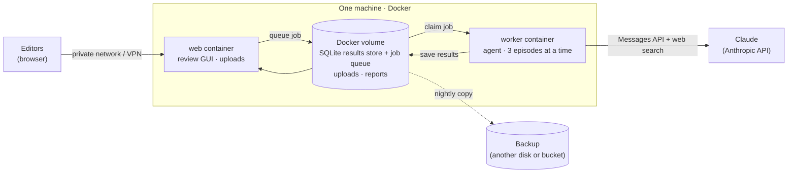
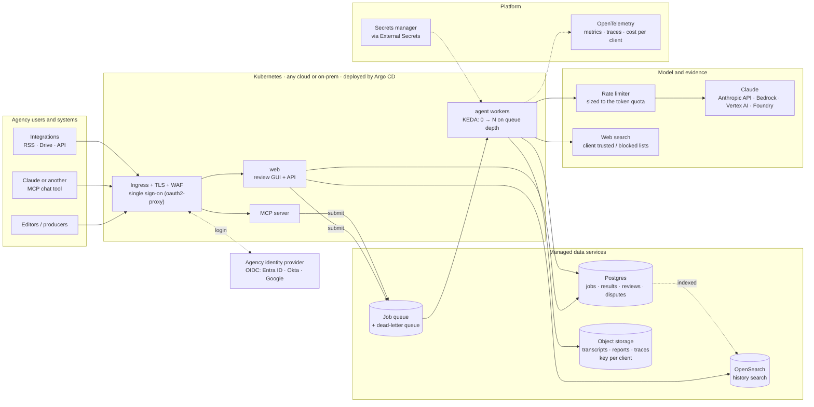
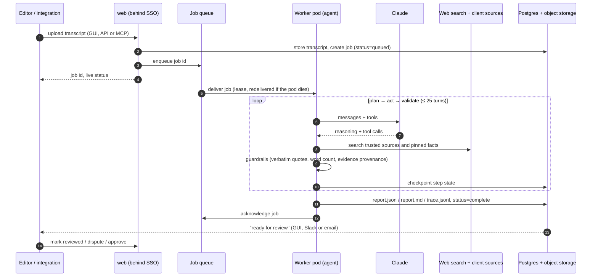
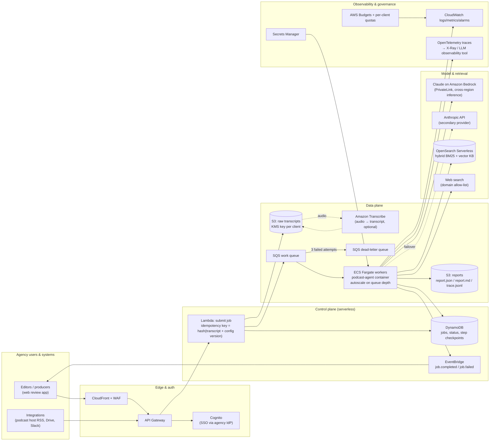
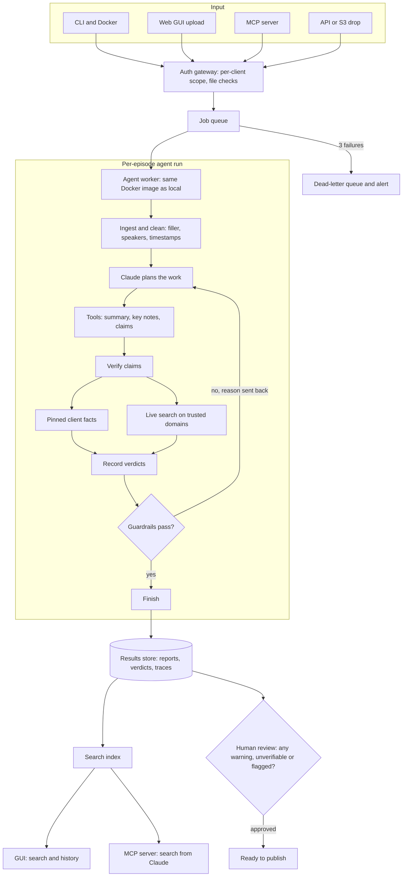
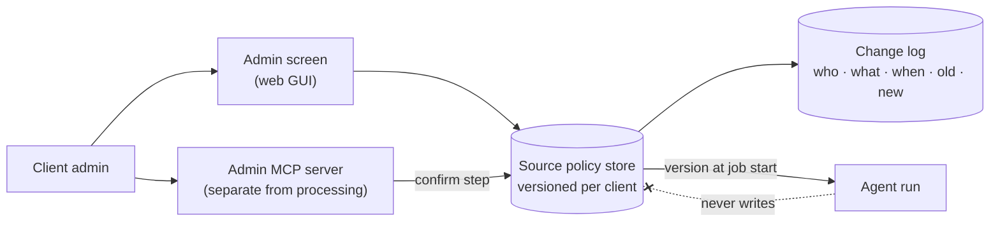
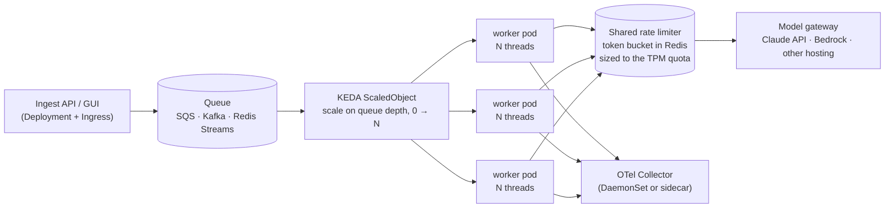
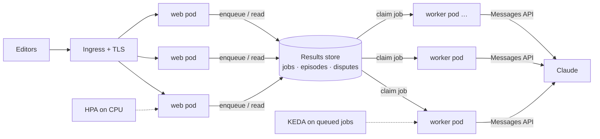
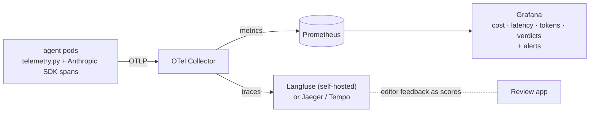
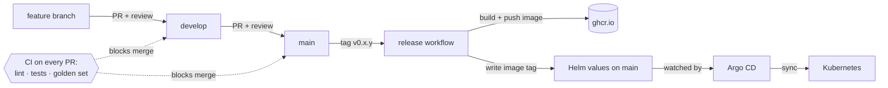

# Deployment strategy

How the podcast agent would run in production for an ad agency: dozens to thousands of
episodes a month, several client brands, editors who review everything before it is
published, and a budget someone has to answer for.

> **Design principle:** the container that runs on a laptop (`docker compose up`) is the
> same container that runs in production. Production adds a queue in front of it, durable
> storage behind it, and observability around it. It does not change the agent.

> **Where this stands.** The project is in **beta (v0.x)** and today runs on **one machine with Docker**
> (§0). Everything from §1 on is the **long-term strategy**: what it grows into, in stages (§12), as
> usage, clients and uptime needs grow. Nothing in §1 has to exist before the first agency can use it.

---

## 0. Today: beta on one machine

The whole system runs with `docker compose` on a single machine: a laptop for development, or one small
cloud VM for a beta with real editors. This is what is built and tested today.



| | Beta on one machine |
|---|---|
| **Start it** | `docker compose up -d web worker` (GUI on port 8501); the CLI batch run uses the same image |
| **Throughput** | The sample run processed 5 episodes in about 2 minutes, 3 at a time. One machine handles well over a hundred episodes an hour, far more than "dozens to thousands a month"; the API rate limit is reached before the machine is busy |
| **Cost** | Model spend (about $0.15–0.30 an episode) plus one small VM |
| **Reliability** | Jobs left running by a crash are re-queued on restart; every multi-row write is one transaction; `restart: unless-stopped` brings the containers back after a reboot |
| **Security** | No login yet: reachable only on a private network or VPN. The API key lives in `.env` on that machine, never in git |
| **Data** | One SQLite file on a Docker volume; back it up nightly to another disk or a storage bucket |

**What one machine does not give you, and why the later stages exist.** Throughput is not the reason
to move on; these are:

| Limit of one machine | Fixed by | Stage (§12) |
|---|---|---|
| The machine is a single point of failure: if it is down, nobody can review | Several pods across zones, managed data services | Production |
| No single sign-on, roles or per-client access | SSO at the Ingress, roles from the agency's identity provider | v1.0 ([ROADMAP](ROADMAP.md)) |
| Several clients share one database file | Postgres with client scoping, a storage prefix and key per client | v1.0 |
| Backups and upgrades are manual | Managed backups; Argo CD rolls out a new version and rolls it back | Pilot → Production |
| One person has to look after the box | The platform team's cluster and monitoring | Production |

---

## 1. Architecture at a glance

**Default: Kubernetes, on whatever cloud the agency already uses.** The same container runs as two
Deployments from the Helm chart in [`deploy/`](../deploy): `web` (review GUI, API, MCP server) and
`worker` (the agent). Argo CD keeps the cluster in step with `main`. Stateful pieces are the cloud's
managed services; the cluster itself holds no data.



- **Why Kubernetes by default.** It runs the same container on any cloud (EKS, AKS, GKE, OKE) or
  on-prem (OpenShift, Rancher), so the design follows the agency rather than one vendor. One Helm chart
  covers every environment, and Argo CD makes a release a commit.
- **Why workers scale on queue depth.** An episode spends nearly all its time waiting on Claude, so
  throughput comes from more episodes in flight, not more CPU. KEDA adds worker pods as the queue grows
  and scales to zero when it is empty, so idle time costs nothing. The real ceiling is the model's
  token quota, which the shared rate limiter protects.
- **Why managed data services.** Postgres, OpenSearch, the queue and object storage hold everything that
  matters, with the cloud's backups and multi-zone replicas. Pods can be replaced at any time.
- **Model access is a setting, not a rewrite.** Claude through the Anthropic API works everywhere; on a
  cloud with its own Claude endpoint (Bedrock, Vertex AI, Microsoft Foundry) traffic can stay inside the
  agency's account. Only `llm.py` changes.
- **Today's build is the same shape, smaller.** `docker compose` runs `web` and `worker` with SQLite as
  the store and queue; the Helm chart runs the same two roles on a cluster. v1.0 swaps in the managed
  services ([ROADMAP](ROADMAP.md)).

### Runs on any cloud

Every box in the diagram has a managed equivalent on each major cloud, and an open-source one on-prem.
Later sections name AWS services where they give a concrete example; this table gives the equivalent.

| Building block | AWS | Azure | Google Cloud | Oracle Cloud | On-prem / any |
|---|---|---|---|---|---|
| Kubernetes | EKS | AKS | GKE | OKE | OpenShift, Rancher |
| Ingress, TLS, WAF | ALB + WAF | Application Gateway + WAF | Cloud Load Balancing + Cloud Armor | OCI Load Balancer + WAF | NGINX Ingress |
| Single sign-on (OIDC) | Cognito or the agency IdP | Entra ID | Google Workspace / Identity Platform | OCI IAM Identity Domains | Okta, Keycloak |
| Job queue | SQS | Service Bus | Pub/Sub | OCI Queue | Redis Streams, RabbitMQ |
| Postgres | RDS / Aurora | Azure Database for PostgreSQL | Cloud SQL | OCI Database with PostgreSQL | CloudNativePG |
| Search | OpenSearch Service | Azure AI Search | Elastic Cloud on GCP | OCI Search with OpenSearch | OpenSearch |
| Object storage | S3 | Blob Storage | Cloud Storage | Object Storage | MinIO |
| Secrets and keys | Secrets Manager + KMS | Key Vault | Secret Manager + Cloud KMS | OCI Vault | HashiCorp Vault |
| Claude | Bedrock or Anthropic API | Microsoft Foundry or Anthropic API | Vertex AI or Anthropic API | Anthropic API | Anthropic API |
| Image registry | ECR | ACR | Artifact Registry | OCIR | Harbor (GHCR today) |
| Observability | CloudWatch, X-Ray | Azure Monitor | Cloud Monitoring, Cloud Trace | OCI Monitoring | Prometheus, Grafana, Jaeger |
| Delivery | Argo CD | Argo CD | Argo CD | Argo CD | Argo CD |

### One episode, end to end



### 1a. AWS managed-services variant (no cluster to run)

For an agency that is all-in on AWS and has no platform team to run Kubernetes, the same container runs
on **ECS Fargate** behind **SQS**, with a serverless control plane. It trades portability for less to
operate. Choose it when there is no existing cluster and no plan to run on another cloud.



---

## 2. End-to-end flow: from upload to published show notes



**What runs in parallel.** Episodes run in parallel (today: a thread pool, `--concurrency`; in
production: more workers pulling from the queue). Inside one episode Claude batches independent
tool calls (several searches, many verdicts) in one turn, but the turns themselves stay sequential
because each depends on the last. The work is almost all waiting on the network, so threads give the
full speed-up locally; scale-out in production comes from the queue and worker count, not from
switching to asyncio. Total concurrency is kept under the account's tokens-per-minute limit, and the
SDK retries rate-limit errors with backoff.

---

## 3. Component choices and why

| Concern | Default (Kubernetes, any cloud) | AWS managed variant (§1a) | Why |
|---|---|---|---|
| Compute | `web` and `worker` Deployments from the Helm chart | ECS Fargate | The same image as local development. Agent runs take 1–4 minutes with state held in memory, which suits long-running pods or tasks rather than 15-minute-capped functions |
| Work distribution | The cloud's queue with a dead-letter queue (or Redis Streams); KEDA scales workers on its depth | SQS + DLQ | Absorbs upload bursts so they never hit model rate limits; at-least-once delivery with redrive; queue depth is the scaling signal |
| Jobs and results | Postgres behind the `ResultStore` interface (SQLite today) | DynamoDB + S3 | One interface in [`store.py`](../src/podcast_agent/store.py), so the agent, worker and GUI never change |
| Search over history | OpenSearch | OpenSearch Serverless | Editors search past episodes, quotes and claims and filter by verdict (§5) |
| Files | Object storage, one prefix and key per client | S3 + KMS | Transcripts, reports and traces; lifecycle rules archive old ones |
| Model access | Claude through the Anthropic API, or the cloud's own endpoint (Bedrock, Vertex AI, Microsoft Foundry) | Bedrock first, Anthropic API as fallback | Only `llm.py` changes. A cloud endpoint keeps traffic in the agency's account; two routes give a fallback during an outage |
| Evidence | **Live web search steered by a per-client source policy** (trusted domains, blocked domains, pinned facts) | Same | The client decides what counts as evidence, and live results are fresher than stored facts (§4) |
| Front end and login | Review GUI and MCP server behind oauth2-proxy and the agency's identity provider | CloudFront + Cognito federated to that provider | Editors review and sign off before anything is published; nobody manages passwords in the app |
| Delivery | GitHub Actions → image registry → Helm values → Argo CD | GitHub Actions → ECR → ECS blue/green | Every prompt or model change ships as a new image version, gated by the golden set (§14) |

**Why Kubernetes is the default.** Agencies already run on different clouds; one chart deploys the same
system into any of them, and adding a client environment is a values file, not a new design. The AWS
variant is the better choice only when nobody will run a cluster.

---

## 4. Trusted sources in production

The build already applies a per-client policy from a JSON file (`data/clients/<client>.json`,
enforced in `sources.py` and `tools.py`). Production adds ownership, change control and an audit trail.



| Concern | Design |
|---|---|
| Onboarding | Agree the trusted and blocked lists (by topic) and any pinned facts with each agency before go-live |
| Who can change it | Admin users of that client only; each user is scoped to their own client's policy |
| How | Admin screen in the GUI, or tools on a **separate admin MCP server**: read lists; add/remove trusted domain; add/remove blocked domain; add/edit/remove pinned fact |
| Safety | Every write needs an explicit confirmation step; every change is logged (who, what, when, old value, new value) |
| Prompt injection | The agent has **no** tool that writes the policy. A transcript is untrusted and could ask Claude to "trust" a domain; keeping writes out of the processing session closes that hole |
| Consistency | Changes apply from the next run, never mid-run. Each report stores the policy version (`source_policy_version`) it was produced under |
| Re-checking | When a policy changes, past episodes can be re-run and the new verdicts compared with the old ones |
| Precedence | Pinned client facts first for client-specific claims; trusted domains carry full confidence; evidence only from other sites is capped and goes to a person; pinned-vs-live conflicts always go to a person |

---

## 5. Results store and search

The agent, the worker and the GUI all write and read through one small interface
([`store.py`](../src/podcast_agent/store.py) `ResultStore`), so the backend can change without touching them.

| | Today (v0.x, built) | Production (v1.0) |
|---|---|---|
| Tables | SQLite file on a Docker volume shared by the `web` and `worker` containers | Postgres |
| Search | SQLite FTS5 full-text index | OpenSearch |
| Report files | `output/<episode>/report.json`, `report.md`, `trace.jsonl` (the brief asks for files) | Object storage, one prefix per client |
| Extra services to run | None | Managed Postgres + OpenSearch |

| Table | Holds |
|---|---|
| `episodes` | id, client, title, host, guests, processed time, model, cost, status, **release and prompt version**, full report |
| `transcript_lines` | episode id, timestamp, speaker, raw text, clean text, ingest flags |
| `notes` | episode id, summary, takeaways, quotes with timestamps, tags |
| `claims` | episode id, claim, speaker, timestamp, type, verdict, confidence, rationale, sources, review flag |
| `reviews` | episode id, claim id, who signed it off, when (claims flagged for human review) |
| `disputes` | claim or quote id, a copy of its text, note, open/resolved, who, when, resolution |
| `jobs` | the upload queue: file, client, status, live progress message, attempts, cost |

A rerun replaces an episode's results in one transaction; disputes are kept, because each carries a
copy of the text it disputes. Review sign-offs are cleared, because a rerun can change the verdicts. What clients can do with it: search past episodes, quotes and claims;
filter claims by verdict (every ⚠️ this quarter); see how a recurring claim was judged over time; rerun
old episodes after a source-policy change and compare verdicts; feed resolved disputes into the golden set.

Every query is scoped to the client making it.

---

## 6. Delivery: how people use it

One results store sits behind every front end; a client uses whichever fits.

| Option | Who it's for | What it does | Effort |
|---|---|---|---|
| **CLI / Docker** (built) | Engineers, the panel | Batch-process files, write reports | Done |
| **Web GUI** (built) | Editors and producers | Upload transcripts, watch job status live, review the report next to the raw and clean transcript, jump from a quote or claim to its line, search history, raise and resolve disputes. v1.0 adds approve-and-publish, the sources admin page and single sign-on ([ROADMAP](ROADMAP.md)) | Done (Streamlit); a React front end only if editors outgrow it |
| **MCP server** | Teams who live in Claude or another MCP-capable chat | `submit_episode`, `get_report`, `search_results` from inside the chat. Read/search tools here; source-list writes only on the separate admin MCP server | Small: wraps the same `PodcastAgent.run` and results store |
| **API** | Agencies plugging into their own tools, podcast-host or RSS integrations | `POST /episodes` → `202` + job id; webhooks / EventBridge on completion | Small: API Gateway + the submit Lambda below |
| **Slack notifications** | Everyone | "Ready for review" with a link | Small |

All of them reuse the agent unchanged; only the entry point differs.

---

## 7. Scalability: threads today, Kubernetes next, asyncio when it pays

**Where the time goes** (measured, ep003): 35.9 s waiting on Claude across 4 turns, 0.14 s running our own
tools and guardrails. The work is network-bound, so concurrency, not CPU, is what scales it. The AWS managed
variant in §1a (ECS Fargate + SQS) is the same design with Fargate tasks in place of pods.

| Stage | Runs on | Concurrency | Move on when |
|---|---|---|---|
| **1. Today** | One container (laptop, VM) | `ThreadPoolExecutor`, `--concurrency` episodes at once (default 3) | More than one machine is needed |
| **2. Kubernetes workers** | The same image as a Deployment on the platform's cluster (your own cloud, EKS/AKS/GKE/OpenShift, or a client's) | More **pods**, each running N threads; pods pull jobs from a queue | One pod needs hundreds of calls in flight |
| **3. asyncio in the pod** | Same pods | `AsyncAnthropic` + `asyncio.gather`: hundreds of in-flight calls per process | It is a density/cost gain, not a requirement |



| Concern | Kubernetes answer |
|---|---|
| Packaging | One Helm chart: worker Deployment, ingest Deployment, KEDA ScaledObject, PodDisruptionBudget, NetworkPolicies |
| Autoscaling | **KEDA** on queue depth (scale to zero overnight); HPA on CPU is the wrong signal for network-bound work |
| The real ceiling | The model's tokens-per-minute quota. Pod retries are not coordinated, so a **cluster-wide token bucket** (Redis) gates every call; the SDK still backs off on 429 |
| Config | Client source policies as a versioned store (or ConfigMaps at first); secrets via External Secrets / the cloud's secret store |
| Model access | Behind a gateway, so the provider or a self-hosted model can change without touching the agent (`llm.py` is already the only provider-specific file) |
| Graceful shutdown | `terminationGracePeriodSeconds` > one episode (~2 min); unfinished jobs return to the queue and resume from the checkpoint |

| Load | What scales | How |
|---|---|---|
| Upload bursts (a client drops a back catalogue of 500 episodes) | The queue absorbs it | Work is queued, not rejected; the API answers `202` immediately |
| Steady throughput | Worker pods × threads per pod | KEDA target: queue depth per pod; total in-flight calls sized under the TPM quota |
| Long episodes (2–3 h, ~30k words) | Context | ~45k tokens fits comfortably in a 1M-token context, so no chunking is needed for normal shows. For very long or multi-part content, a map-reduce step summarises segments first |
| Back-catalogue jobs that are not urgent | Batch API | Route to the Message Batches API at 50% of the price, accepting up to 24 h turnaround |

---

### How the GUI scales



- The web GUI is its own container and is **stateless**: uploads, jobs and results live in storage.
- In Kubernetes: 2–3 web pods behind an ingress, scaled by a horizontal pod autoscaler on traffic.
- Agent workers are a separate Deployment, scaled on job-queue depth by KEDA (0 → N).
- There is no web server per worker or per thread. The layers scale independently and talk only
  through the job queue and the results store.
- Locally, docker-compose runs one `web` and one `worker` container on a shared volume.

---

## 8. Fault tolerance


- **Idempotency.** The job key is `hash(transcript + prompt version + model + KB version)`. A duplicate upload returns the existing job; a retried message never produces two reports.
- **Graceful degradation.** A run that cannot finish still writes what it has, marked `incomplete` and naming what is missing, instead of losing the work.
- **No single points of failure.** The managed data services replicate across zones; worker and web pods spread across at least two zones, and a PodDisruptionBudget keeps one of each running through node upgrades.
- **Poison messages** land in the DLQ after three attempts, raise an alarm, and can be replayed after a fix.

---

## 9. Cost

**Measured locally** with `claude-opus-5-5` at `medium` effort and live web search on five short episodes (~5–6 minutes of audio each): about $0.15–0.30 per episode, $1.15 for the run. See [`examples/sample_run/index.md`](../examples/sample_run/index.md) for per-episode figures. Token use scales with transcript length and the number of claims checked; web search results add input tokens, and searches are billed per use on top of tokens. Offline mode (`--no-web-search`) is cheaper but less fresh.

| Lever | Effect | Trade-off |
|---|---|---|
| Prompt caching (already on) | The growing conversation is re-read each turn at ~10% of the input price | None |
| Effort `low` / `medium` | Fewer reasoning tokens per turn | Measure quality on the eval set before lowering |
| Smaller model for the bulk steps (e.g. Claude Sonnet 5.5 or Haiku 5.5 for claim extraction; Opus for verdicts) | Large share of tokens moves to a cheaper model | More moving parts; validate per step |
| Message Batches API for back catalogues | 50% off | Up to 24 h latency |
| Spot / preemptible nodes for worker pods (Fargate Spot on AWS) | ~60–70% off compute | Interruptions are already handled by checkpoints and queue redelivery |
| Per-client quotas + cloud budget alarms | Caps runaway spend | Needs a quota policy agreed with account leads |

Infrastructure cost is small next to model spend: at a few thousand episodes a month, a small managed cluster (two or three nodes, with workers scaling to zero when idle), managed Postgres, OpenSearch and object storage are typically low hundreds of dollars a month on any of the major clouds. The AWS managed variant lands in the same range, dominated by the OpenSearch Serverless minimum capacity.

---

## 10. Security, privacy and compliance

| Risk | Control |
|---|---|
| Client content leaking between brands | Client id on every job and every query; one storage prefix and one encryption key per client (S3 + KMS on AWS, Blob + Key Vault on Azure); access policies tied to the client id; reports never mixed in one index. |
| Prompt injection inside a transcript ("ignore your instructions…") | The transcript is wrapped and labelled as untrusted data in the prompt; the agent's tools have **no side effects outside the job** (no email, no publishing), so the worst case is a bad report that a human reviews. |
| Hallucinated facts or quotes | Guardrails in code: quotes must match the transcript verbatim; a "verified" verdict must cite a source the agent actually retrieved; summaries must meet the length spec. Editors approve before publishing. |
| Secrets | No long-lived keys where the cloud's own Claude endpoint is used: pods get a workload identity (IRSA on AWS, Workload Identity on GKE and AKS). An Anthropic API key, if used, lives in the cloud's secrets manager and reaches the pod through External Secrets. |
| Data residency / retention | The cluster, data services and model endpoint run in the client's region; storage lifecycle rules and database retention jobs implement the period in each client contract; model providers do not train on API data. |
| Network | Nodes in private subnets; private endpoints to the data services and the model; egress only through a NAT or egress gateway with an allow-list for the model API and the web-search provider. |
| Audit | `trace.jsonl` records every reasoning summary, tool call and result for each report; the cloud's audit log (CloudTrail, Azure Activity Log, Cloud Audit Logs) covers infrastructure actions. |
| Who can use it | **Today there is no login**: run it on a private network or VPN, never on the open internet. v1.0 adds single sign-on: OIDC at the Ingress (oauth2-proxy in front of the GUI and the MCP server) against the agency's identity provider (Entra ID, Okta, Google Workspace, or Cognito federated to one), with MFA set by the agency's own policy. See [ROADMAP](ROADMAP.md#single-sign-on-and-access). |
| Roles and client scope | IdP groups map to roles (editor, lead, admin) and to the clients a user may see; store queries are filtered to those clients. Only admins change source lists, and every change is audited. |
| Accountability | Every sign-off and dispute already records who and when; with SSO, "who" is the verified identity from the IdP instead of a typed name. |
| Pods on Kubernetes | Non-root and a read-only root filesystem (in the chart today); the web pod has no API key because it never calls Claude. v1.0 adds NetworkPolicy: web → store only; workers → store plus egress to the model API and the search allow-list. |
| Secrets on Kubernetes | The chart references the API-key Secret by name only; External Secrets syncs it from AWS Secrets Manager, Azure Key Vault or Vault, so it never sits in git and rotates without a redeploy. |
| Supply chain | Branch protection on `main` (required CI and review); image scanning and an SBOM in the release workflow; Dependabot for dependencies (v1.0). |

---

## 11. Observability: latency, tokens, cost and quality

**Built in the repo.** Every report already records latency per model turn and per tool, tokens and cost
(`metrics` in `report.json`, `model_call` / `tool_timing` events in `trace.jsonl`). With `--otel` the agent
also emits OpenTelemetry traces and metrics (`src/podcast_agent/telemetry.py`), and
`docker compose -f observability/docker-compose.yml up -d` starts an optional local Collector, Prometheus, Jaeger and Grafana
with a ready-made dashboard. In production the same instrumentation points at the cluster's collector.



| Tool | Answers | For |
|---|---|---|
| **Langfuse** (traces) | What did the agent do on *this* episode: each turn, tool call, latency, tokens, cost, plus editor feedback as quality scores | AI engineers, quality review |
| **Prometheus + Grafana** (metrics) | How is the system doing: cost per episode by client, p95 latency, tokens/min against quota, rejection rate, verdict mix, queue age; alerting | Ops, account leads, finance |
| **Claude API tracing** (optional) | Server-side spans from the API itself (each model request inside a call, server-side web search), joined to ours by `traceparent` | Deep latency debugging; an org admin adds an OTLP destination in the Console |

Trace shape: `podcast_agent.episode` → `podcast_agent.turn` (×N, each containing the SDK's
`anthropic.messages.create`) and `podcast_agent.tool` (×M). SDK spans are **metadata only** (model, tokens,
timing), never prompts. Traces in content mode would contain client transcripts, so Langfuse runs
**self-hosted inside the cluster** with per-client retention, not as a SaaS.

| Metric (Prometheus name) | Labels | Alert when |
|---|---|---|
| `podcast_agent_episode_duration_seconds` (histogram), `podcast_agent_episode_time_seconds_total` | client, model, status | p95 > 10 min (the SLO) |
| `podcast_agent_model_call_duration_seconds` | client, model | p95 doubles vs the 7-day baseline |
| `podcast_agent_tool_call_duration_seconds` | tool, outcome | — (diagnostic) |
| `podcast_agent_tokens_total` | type (input/output/cache_read/cache_write) | tokens/min > 80% of the quota |
| `podcast_agent_cost_usd_total` | client, model | cost per episode > 2× the 7-day median; budget burn |
| `podcast_agent_guardrail_rejections_total` | tool | sudden rise (prompt or model regression) |
| `podcast_agent_verdicts_total`, `podcast_agent_needs_review_total` | verdict | mix shifts after a model, prompt or policy change |
| `podcast_agent_episodes_total` | status | failures > 2% in an hour |
| Queue age / depth, DLQ depth | (from the queue) | oldest message > 15 min; DLQ > 0 |

Episode ids go on spans, never on metric labels (cardinality). Counters are published at zero when a worker
starts, so `increase()` also counts the first episode of a short-lived process.

**Evaluation gate in CI.** A golden set of transcripts with expected claims, verdicts and quote checks runs on every change to prompts, tools, model or KB. A release is blocked if verdict accuracy or guardrail pass rate drops. Editor corrections from the review app are added to the golden set over time; in Langfuse they attach to the episode's trace as scores.

---

## 12. Rollout plan

| Phase | Scope | Exit criteria |
|---|---|---|
| 0. Beta (v0.x, today) | **One machine with Docker** (§0): CLI, review GUI + queue worker, SQLite results store, client source policies, threads, golden set, CI; Helm chart written, optional OTel stack | A few editors use it for real episodes; reports need only minor edits |
| 1. Pilot (2–3 weeks) | One client on a small managed Kubernetes cluster in the agency's cloud (or the AWS variant), editors review in the GUI | ≥ 90% of reports approved with minor edits |
| 2. Production | Kubernetes workers + KEDA, shared rate limiter, review app, results store, self-hosted Langfuse + Grafana alerts, per-client isolation, CI eval gate | SLOs: 95% of episodes ready < 10 min; < 1% failures |
| 3. Scale-out | asyncio workers where density pays, audio ingestion, Batch API for back catalogues, cheaper model routing per step, social-post generation | Cost per episode down 40% at equal quality |

---

## 13. Delivery pipeline: branches, CI, Helm and Argo CD



| Step | What happens | Where |
|---|---|---|
| Develop | Work on `develop`, starting at v0.1. Merge to `main` for production through a reviewed pull request | Branch protection |
| CI on every PR | `ruff`, unit + agent-loop + GUI smoke tests (scripted model, no key), and a free check of the golden-set scorer; any failure blocks the merge | [`.github/workflows/ci.yml`](../.github/workflows/ci.yml) |
| Live golden set, on request | Add the `run-golden` label to a PR (or Actions → ci → Run workflow). It runs the golden episodes on Claude (about $1.20), posts the regression report on the PR, then removes the label so each run is deliberate. Use it for changes to prompts, tools, model, KB or source policies, and before each release | [`.github/workflows/ci.yml`](../.github/workflows/ci.yml) |
| Release | Tag `v0.2.0` → build the image, push it with that tag, write the tag into the Helm values | [`.github/workflows/release.yml`](../.github/workflows/release.yml) |
| Deploy | Argo CD watches the chart on `main` and syncs the cluster | [`deploy/argocd/application.yaml`](../deploy/argocd/application.yaml) |
| Later | A staging environment synced from `develop` before production | — |

### What goes where

| Setting | Helm values | Database | Kubernetes Secret (outside git) |
|---|---|---|---|
| GUI on/off, MCP server on/off | ✅ | | |
| Replicas and autoscaling limits (web, workers) | ✅ | | |
| Model and reasoning effort, concurrency per worker | ✅ | | |
| Image tag (set by CI), resources, ingress host and TLS | ✅ | | |
| Name of the secret holding the API key | ✅ | | |
| Default trusted-source list to seed a new client | ✅ optional | | |
| Each client's trusted / blocked sources and pinned facts | | ✅ changed often via GUI or MCP; a redeploy per edit would be wrong | |
| The API key | | | ✅ e.g. External Secrets from a vault |

| In GitHub | Never in GitHub (enforced by `.gitignore` and `.dockerignore`) |
|---|---|
| Source code and tests; Dockerfile and compose files | API keys; any `.env` with real values |
| Helm chart with default values; Argo CD application | Each client's real source lists and pinned facts |
| `.env.example`; the fictional sample client policies as seed files | The results database, uploaded transcripts and client reports |
| Docs, sample outputs under `examples/`, CI workflows, `CHANGELOG.md` | |

The chart is [`deploy/helm/podcast-agent`](../deploy/helm/podcast-agent). Today the chart targets the SQLite store, so it
runs one web pod and one worker pod on one volume, and refuses, with a clear message, settings that need the
v1.0 Postgres store: more replicas, the HPA, KEDA, or the MCP server. Pods run as non-root with a read-only
root filesystem, and the web pod has no API key at all because it never calls Claude. Until the v1.0 sources
admin page moves client policies into the database, real policy files are mounted from a ConfigMap created
outside git (`clients.existingConfigMap`).

## 14. Versioning, regression and rollback

**Versioning.** Releases use semantic version tags (v0.1.0; v0.2.0 for a feature, v0.1.1 for a fix), and
[`CHANGELOG.md`](../CHANGELOG.md) lists what changed. Prompts, the model name and the source policies are
versioned with the code, never edited live. Every stored result records `code_version` (release + build
commit), `prompt_version` (a fingerprint of the system prompt and tool contracts), the model and the
source-policy version, so any verdict traces to the exact release that produced it.

**Regression.** The golden set ([`data/golden/golden.json`](../data/golden/golden.json)) lists the claims an
editor expects in each sample episode and the verdicts they accept. `podcast_agent eval` scores a run on
claim recall, verdict accuracy and quote validity, compares it with the last release's run, and fails if
accuracy drops or a quote stops matching. CI posts the report on the pull request: verdicts that changed,
cost and run-time differences.

```bash
python -m podcast_agent run data/transcripts data/samples --out new_run
python -m podcast_agent eval new_run --baseline examples/sample_run --md regression.md
```

**Seeing what changed.** Code: a GitHub compare of two tags, or `git diff v0.1.0 v0.2.0`. Output: rerun an
episode on both versions and compare the reports, which shows which verdicts or quotes changed.

**Adding a feature:**

1. Branch from `develop`, build the feature, add its tests.
2. Open a pull request. CI runs lint and the tests. If the change can affect the agent's answers (prompts,
   tools, model, KB, source policies), add the `run-golden` label to run the live golden-set regression.
3. Review the code diff and, when run, the regression report, then merge to `develop`.
4. Merge `develop` to `main` and tag the release. Argo CD deploys it.
5. If it breaks, roll back.

**Rollback.** Revert the release commit on `main`, or set the Helm image tag back to the previous version;
Argo CD syncs the cluster back within minutes, and its history can redeploy an earlier release from the UI.
Because every result records its version, anything the bad release produced can be found and rerun.
Later: feature flags, so a feature can be switched off without a redeploy.

## 15. Testing approach

A one-to-one ratio of test lines to code lines is not the goal; it is easy to hit without testing what
matters. Tests sit where the risk is:

| Area | What is tested |
|---|---|
| Guardrails | A paraphrased quote is rejected; a verdict citing an unseen source is rejected; word counts enforced; `finish` blocked until complete |
| Ingest | Timestamp formats, speaker mapping, filler removal, stutters, raw text never modified, hostile files |
| Agent loop | End-to-end run with a scripted fake model, including self-correction after a rejection |
| Store and worker | A rerun keeps disputes and clears review sign-offs; marking a claim reviewed lowers the needs-review count; two workers never take the same job; a bad upload fails only its job; odd search input never breaks a query |
| GUI | Every page renders; the report shows verdicts and raw vs clean; a quote jumps to its line; transcript HTML is escaped; disputes resolve; a flagged claim can be marked reviewed and undone |
| Quality | The golden set, run in CI on every prompt, model or source change |

Coverage is tracked on the guardrail, ingest, tools and store modules, and kept high there rather than
across the whole codebase.
