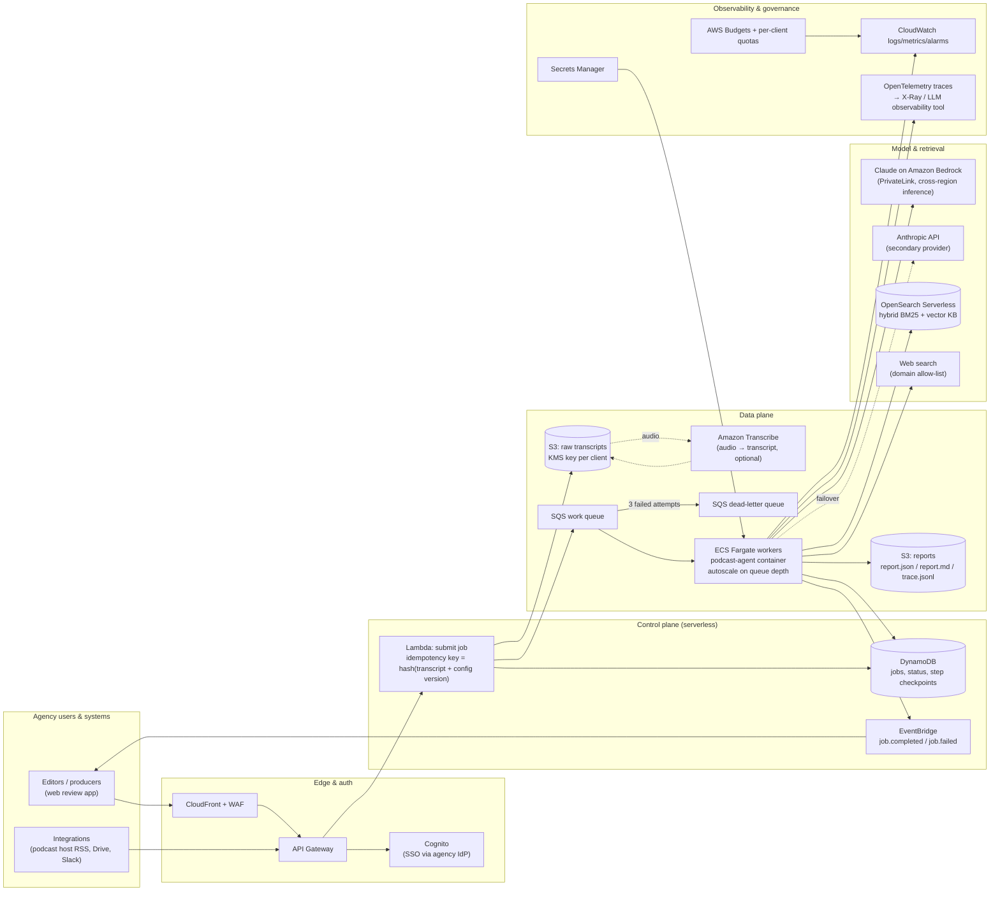
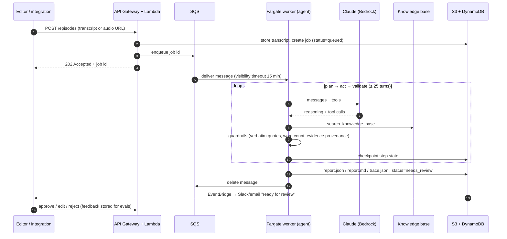
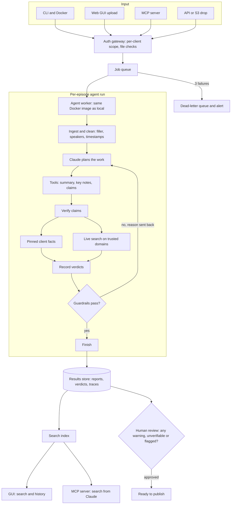
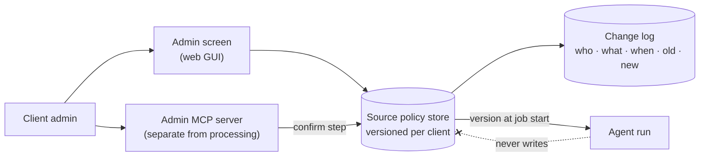
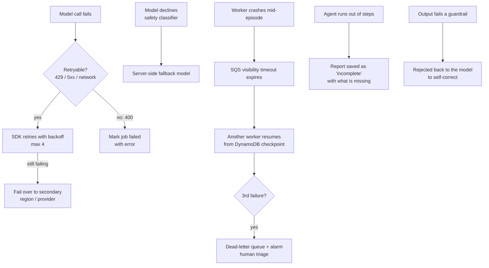

# Deployment strategy

How the podcast agent would run in production for an ad agency: dozens to thousands of
episodes a month, several client brands, editors who review everything before it is
published, and a budget someone has to answer for.

> **Design principle:** the container that runs on a laptop (`docker compose up`) is the
> same container that runs in production. Production adds a queue in front of it, durable
> storage behind it, and observability around it. It does not change the agent.

---

## 1. Architecture at a glance

### One episode, end to end

---

## 2. End-to-end flow: from upload to published show notes

**What runs in parallel.** Episodes run in parallel (today: a thread pool, `--concurrency`; in
production: more workers pulling from the queue). Inside one episode Claude batches independent
tool calls (several searches, many verdicts) in one turn, but the turns themselves stay sequential
because each depends on the last. The work is almost all waiting on the network, so threads give the
full speed-up locally; scale-out in production comes from the queue and worker count, not from
switching to asyncio. Total concurrency is kept under the account's tokens-per-minute limit, and the
SDK retries rate-limit errors with backoff.

---

## 3. Component choices and why

| Concern | Choice | Why this over the alternatives |
|---|---|---|
| Compute | **ECS Fargate** running the existing container | Same image as local dev (no "works on my laptop"). Agent runs take 1–4 min with long-held state; Fargate has no 15-minute cap and no cold-start penalty per step. Lambda + Step Functions is a good fit at very low volume; EKS is overkill for one service. |
| Work distribution | **SQS + DLQ** | Decouples upload bursts from model rate limits; at-least-once delivery with redrive; queue depth is the autoscaling signal. |
| Job state | **DynamoDB** | Job status, idempotency keys and per-step checkpoints; single-digit-ms writes, no capacity planning. |
| Model access | **Claude on Bedrock** (primary), **Anthropic API** (secondary) | Bedrock keeps traffic inside the AWS account (IAM, PrivateLink, no API keys, data stays in-region). `llm.py` is the only file that changes to swap providers. Cross-region inference absorbs regional capacity issues. |
| Evidence | **Live web search steered by a per-client source policy** (trusted domains, blocked domains, pinned facts) | The customer decides what counts as evidence; live results are fresher than stored facts. Pinned facts and the offline KB move to a managed index behind the same `search()` interface. See §4. |
| Results store | **S3** (reports, traces) + **DynamoDB** (job status, metadata) + **OpenSearch** (search over summaries, quotes, claims) | Editors search history and verdict trends; see §5. |
| Storage | **S3** with a KMS key per agency client | Reports, traces and transcripts; lifecycle rules move old artefacts to Glacier. |
| Front end | Small review app on **CloudFront + S3**, **Cognito** SSO | Editors approve/edit/reject before anything is published; their edits become evaluation data. |
| Delivery | GitHub Actions → ECR → ECS blue/green (CodeDeploy) | Each prompt/model change ships as a new image version, gated by the evaluation suite (§11). |

---

## 4. Trusted sources in production

The build already applies a per-client policy from a JSON file (`data/clients/<client>.json`,
enforced in `sources.py` and `tools.py`). Production adds ownership, change control and an audit trail.

| Concern | Design |
|---|---|
| Onboarding | Agree the trusted and blocked lists (by topic) and any pinned facts with each agency before go-live |
| Who can change it | Admin users of that client only; each user is scoped to their own client's policy |
| How | Admin screen in the GUI, or tools on a **separate admin MCP server**: read lists; add/remove trusted domain; add/remove blocked domain; add/edit/remove pinned fact |
| Safety | Every write needs an explicit confirmation step; every change is logged (who, what, when, old value, new value) |
| Prompt injection | The agent has **no** tool that writes the policy. A transcript is untrusted and could ask Claude to "trust" a domain; keeping writes out of the processing session closes that hole |
| Consistency | Changes apply from the next run, never mid-run. Each report stores the policy version (`source_policy_version`) it was produced under |
| Re-checking | When a policy changes, past episodes can be re-run and the new verdicts compared with the old ones |
| Precedence | Pinned client facts first for client-specific claims; trusted domains carry full confidence; evidence only from other sites is capped and goes to a person; pinned-vs-live conflicts always go to a person |

---

## 5. Results store and search

The brief needs output files on disk; agencies need to look back. Every finished run is stored and indexed.

| Stored per episode | Where |
|---|---|
| Metadata: client, show, episode, title, host, guests, processed date | DynamoDB |
| Summary, takeaways, quotes with timestamps, tags | S3 (`report.json`) + OpenSearch |
| Every claim with verdict, confidence, rationale, evidence tiers, review flag | S3 + OpenSearch |
| Source policy version; model and prompt version; cost; run time; full trace | S3 (`trace.jsonl`) + DynamoDB |
| Review status (pending / approved / edited / rejected) and approver | DynamoDB |

Raw reports and traces live in S3, one prefix per client, encrypted with a key per client. What clients
can do with it: search past episodes by topic, guest, quote or claim; filter claims by verdict (e.g.
every ⚠️ in the last quarter); see how a recurring claim was judged over time; re-run old episodes
after a source-policy change and diff the verdicts; and feed editor corrections into the evaluation
set. Every query is scoped to the client making it.

---

## 6. Delivery: how people use it

One results store sits behind every front end; a client uses whichever fits.

| Option | Who it's for | What it does | Effort |
|---|---|---|---|
| **CLI / Docker** (built) | Engineers, the panel | Batch-process files, write reports | Done |
| **Web GUI** | Editors and producers | Upload transcripts (S3 presigned upload), watch job status, read and approve reports, search history, manage source lists (admins) | Medium: FastAPI + a small React app on CloudFront |
| **MCP server** | Teams who live in Claude or another MCP-capable chat | `submit_episode`, `get_report`, `search_results` from inside the chat. Read/search tools here; source-list writes only on the separate admin MCP server | Small: wraps the same `PodcastAgent.run` and results store |
| **API** | Agencies plugging into their own tools, podcast-host or RSS integrations | `POST /episodes` → `202` + job id; webhooks / EventBridge on completion | Small: API Gateway + the submit Lambda below |
| **Slack notifications** | Everyone | "Ready for review" with a link | Small |

All of them reuse the agent unchanged; only the entry point differs.

---

## 7. Scalability

| Load | What scales | How |
|---|---|---|
| Upload bursts (a client drops a back catalogue of 500 episodes) | SQS absorbs it | Work is queued, not rejected; API answers `202` immediately. |
| Steady throughput | Fargate task count | Target-tracking on `ApproximateNumberOfMessagesVisible / tasks`; 0 → N tasks, each running `PODCAST_AGENT_CONCURRENCY` episodes in parallel. |
| Model rate limits (tokens/min) | A shared concurrency cap | Max tasks × per-task concurrency is sized under the account's TPM quota; SDK backs off on 429 with `retry-after`. Quota increases or provisioned throughput for sustained volume. |
| Long episodes (2–3 h, ~30k words) | Context | ~45k tokens fits comfortably in a 1M-token context, so no chunking is needed for normal shows. For very long or multi-part content, a map-reduce step summarises segments first and the agent works from those. |
| Back-catalogue jobs that are not urgent | Batch API | Route to the Message Batches API at 50% of the price, accepting up to 24 h turnaround. |

---

## 8. Fault tolerance

- **Idempotency.** The job key is `hash(transcript + prompt version + model + KB version)`. A duplicate upload returns the existing job; a retried message never produces two reports.
- **Graceful degradation.** A run that cannot finish still writes what it has, marked `incomplete` and naming what is missing, instead of losing the work.
- **No single points of failure.** Every managed service above is multi-AZ; workers run in at least two AZs.
- **Poison messages** land in the DLQ after three attempts, raise an alarm, and can be replayed after a fix.

---

## 9. Cost

**Measured locally** with `claude-opus-5-5` at `medium` effort and live web search on five short episodes (~5–6 minutes of audio each): about $0.15–0.30 per episode, $1.15 for the run. See [`examples/sample_run/index.md`](../examples/sample_run/index.md) for per-episode figures. Token use scales with transcript length and the number of claims checked; web search results add input tokens, and searches are billed per use on top of tokens. Offline mode (`--no-web-search`) is cheaper but less fresh.

| Lever | Effect | Trade-off |
|---|---|---|
| Prompt caching (already on) | The growing conversation is re-read each turn at ~10% of the input price | None |
| Effort `low` / `medium` | Fewer reasoning tokens per turn | Measure quality on the eval set before lowering |
| Smaller model for the bulk steps (e.g. Claude Sonnet 5.5 or Haiku 5.5 for claim extraction; Opus for verdicts) | Large share of tokens moves to a cheaper model | More moving parts; validate per step |
| Message Batches API for back catalogues | 50% off | Up to 24 h latency |
| Fargate Spot for workers | ~70% off compute | Interruptions are already handled by checkpoints + SQS redelivery |
| Per-client quotas + AWS Budgets alarms | Caps runaway spend | Needs a quota policy agreed with account leads |

Infrastructure cost is small next to model spend: at a few thousand episodes a month, Fargate, SQS, DynamoDB, S3 and OpenSearch Serverless together are typically low hundreds of dollars a month, dominated by the OpenSearch Serverless minimum capacity (a managed vector store with lower floor pricing is an option at small scale).

---

## 10. Security, privacy and compliance

| Risk | Control |
|---|---|
| Client content leaking between brands | Tenant id on every job; S3 prefix + KMS key per client; IAM conditions on the tenant tag; reports never mixed in one index. |
| Prompt injection inside a transcript ("ignore your instructions…") | The transcript is wrapped and labelled as untrusted data in the prompt; the agent's tools have **no side effects outside the job** (no email, no publishing), so the worst case is a bad report that a human reviews. |
| Hallucinated facts or quotes | Guardrails in code: quotes must match the transcript verbatim; a "verified" verdict must cite a source the agent actually retrieved; summaries must meet the length spec. Editors approve before publishing. |
| Secrets | No long-lived keys with Bedrock (IAM task role). Anthropic key, if used, lives in Secrets Manager and is injected at task start. |
| Data residency / retention | Bedrock in the client's region; S3 lifecycle and DynamoDB TTL implement the retention period in each client contract; model providers do not train on API data. |
| Network | Workers in private subnets; VPC endpoints for S3, DynamoDB, SQS, Bedrock; egress only through a NAT with an allow-list for the web-search provider. |
| Audit | `trace.jsonl` records every reasoning summary, tool call and result for each report; CloudTrail covers infrastructure actions. |

---

## 11. Observability and quality

| Signal | Source | Alarm when |
|---|---|---|
| Queue age / depth | SQS | Oldest message > 15 min |
| Job failure rate, DLQ depth | DynamoDB status, SQS | > 2% failed in an hour; DLQ > 0 |
| Cost per episode, tokens per episode | `metrics` block in each report | 2× the 7-day median |
| Guardrail rejection rate | `rejected_tool_calls` | Sudden rise (prompt or model regression) |
| Verdict mix (✅ / ⚠️ / ❓) | Report | Shift after a KB or model change |
| Editor edit distance / rejection rate | Review app | Quality drifting down |

**Evaluation gate in CI.** A golden set of transcripts with expected claims, verdicts and quote checks runs on every change to prompts, tools, model or KB. A release is blocked if verdict accuracy or guardrail pass rate drops. Editor corrections from the review app are added to the golden set over time.

---

## 12. Rollout plan

| Phase | Scope | Exit criteria |
|---|---|---|
| 0. Today | Local Docker, CLI, curated KB | Panel review |
| 1. Pilot (2–3 weeks) | One client, Fargate + SQS + S3, editors review in a shared folder | ≥ 90% of reports approved with minor edits |
| 2. Production | Review app, Bedrock, OpenSearch KB, per-client isolation, CI eval gate | SLOs: 95% of episodes ready < 10 min; < 1% failures |
| 3. Scale-out | Audio ingestion (Transcribe), Batch API for back catalogues, cheaper model routing per step, social-post generation | Cost per episode down 40% at equal quality |
