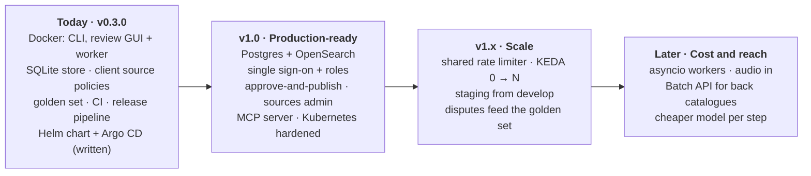
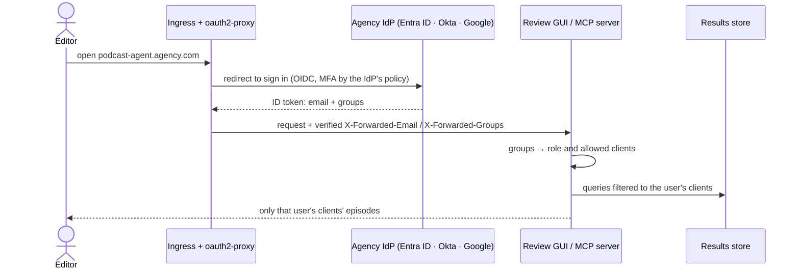

# Roadmap

Where the project stands today, what the next milestone adds, and what comes after. The deployment design
these items build on is in [`DEPLOYMENT.md`](DEPLOYMENT.md); what has already shipped is in
[`CHANGELOG.md`](../CHANGELOG.md).

## Today (v0.3.0)

| Area | State |
|---|---|
| Agent | Plans, summarises, extracts notes and fact-checks with guardrails in code; every step logged |
| Evidence | Live web search steered by each client's trusted / blocked sources and pinned facts; offline KB fallback |
| Review GUI | Upload, live job status, report next to raw and clean transcript, history search, disputes, **Mark reviewed** sign-off |
| Store and worker | SQLite results store and job queue behind one interface; atomic job claims; graceful stop |
| Quality | 113 tests without an API key; golden set, scored free on every PR and live on request (`run-golden` label) |
| Delivery | CI on every PR; a version tag builds the image, publishes it and bumps the Helm tag; Argo CD application |
| Not yet | No login (run it on a private network); one web and one worker pod; the Helm chart has **not yet been installed on a cluster** |

## v1.0: production-ready

The goal is a pilot with one agency client, on Kubernetes, behind the agency's own login.

| # | Item | Why | What changes | Effort |
|---|---|---|---|---|
| 1 | **Postgres + OpenSearch store** | SQLite is one file on one volume, so everything runs as one pod | A second implementation of the `ResultStore` interface in [`store.py`](../src/podcast_agent/store.py); the agent, worker and GUI do not change | M |
| 2 | **Single sign-on and roles** | Anyone who can reach the GUI can use it today | OIDC login at the front door, roles, per-client access ([design below](#single-sign-on-and-access)) | M |
| 3 | **Approve-and-publish** | "Reviewed" is not yet "cleared to publish" | A report state machine: draft → reviewed → approved → published, with who and when for each step | S |
| 4 | **Sources admin page** | Client source lists are files today | Trusted / blocked domains and pinned facts move into the database, edited by admins, every change audited and versioned | M |
| 5 | **MCP server** | Some teams live in Claude or another chat tool | The same agent and store as MCP tools ([below](#mcp-server)) | S |
| 6 | **Kubernetes, for real** | The chart is written but has never run on a cluster | Install on a test cluster; `helm lint` + `helm template` + schema check in CI; NetworkPolicy; External Secrets ([below](#kubernetes)) | M |
| 7 | **Supply chain** | The repo is public; main should only change through review | Branch protection (required CI and review), image scanning and an SBOM in the release workflow, Dependabot | S |

S = days, M = one to two weeks, for one engineer.

## Single sign-on and access

Login happens once, at the Ingress, in front of both the GUI and the MCP server, so neither app stores
passwords. The agency's own identity provider (Microsoft Entra ID, Okta, Google Workspace, or AWS Cognito
federated to one of them) proves who the user is; the app only reads the verified identity and groups.

| Role | Can do | Mapped from (example IdP group) |
|---|---|---|
| **Editor** | Upload, read reports, Mark reviewed, raise disputes | `podcast-agent-editors` |
| **Lead** | Everything an editor can, plus resolve disputes and approve-and-publish | `podcast-agent-leads` |
| **Admin** | Edit client source lists, grant client access, see audit history | `podcast-agent-admins` |
| **Client scope** | Which clients' episodes a user sees at all | `podcast-agent-client-<id>` |

What it changes in the code:

- `who()` in the GUI reads the verified email from the proxy header instead of the typed name, so every
  sign-off, dispute and approval records a real identity.
- Store queries take the user's allowed client ids; a user never sees another brand's episodes.
- The worker and the agent do not change: they run jobs, not users.

## MCP server

A thin server that exposes the agent and the results store to Claude or any MCP-capable chat tool. It reuses
`PodcastAgent.run` and the store, sits behind the same OIDC login (MCP's OAuth flow), and applies the same
roles and client scope.

| Tool | Does | Role |
|---|---|---|
| `submit_episode` | Queue a transcript for processing; returns a job id | Editor |
| `get_report` | Summary, notes and fact-check table for an episode | Editor |
| `search_results` | Full-text search over past episodes, quotes and claims | Editor |
| `list_needs_review` | Claims still flagged for a person | Editor |
| `mark_reviewed` / `raise_dispute` | The GUI's sign-off and dispute, from chat | Editor |

Source-list changes are deliberately **not** on this server; they stay on the admin page, so a chat
conversation can never widen what counts as evidence.

## Kubernetes

| | Today | v1.0 |
|---|---|---|
| Install | Chart and Argo CD application written, not yet installed | Installed on a test cluster, then the pilot cluster, by Argo CD from `main` |
| CI | Lint and tests on the Python code | Plus `helm lint`, `helm template` and a schema check of the rendered manifests |
| Pods | One web and one worker pod (the chart refuses more on SQLite) | Web: HPA 2–3 pods on CPU; workers: KEDA 0 → 10 on queue depth |
| Pod security | Non-root, read-only root filesystem; the web pod has no API key | Plus NetworkPolicy: web → store; workers → store and egress to the model API and search allow-list only |
| Secrets | A Secret referenced by name, created outside git | External Secrets syncs it from AWS Secrets Manager / Azure Key Vault / Vault; rotation without a redeploy |
| Login | None | oauth2-proxy at the Ingress ([SSO](#single-sign-on-and-access)) |
| Environments | One | `staging` synced from `develop`, `production` from `main` |

## v1.x and later

| When | Item | Why |
|---|---|---|
| v1.x | Shared rate limiter (token bucket in Redis, sized to the API quota) | With many worker pods, the token quota, not pods, becomes the limit |
| v1.x | Resolved disputes become golden-set candidates | The regression check grows from real editor corrections |
| v1.x | Feature flags | Switch a new prompt or model off instantly, without a redeploy |
| Later | asyncio workers | Hundreds of in-flight calls per pod; a cost gain, not a requirement |
| Later | Audio in | A transcription step in front of ingest |
| Later | Batch API for back catalogues; a cheaper model for simple steps | Cost per episode down without losing quality, checked against the golden set |
| Later | Social-post generation | The next deliverable editors ask for, built on the same notes |

## Known gaps

| Gap | Plan |
|---|---|
| The Helm chart has not been installed on a cluster | v1.0 item 6: install it on a test cluster and add chart checks to CI |
| No login | v1.0 item 2; until then, run it on a private network or VPN |
| The offline knowledge base was written from model knowledge, not fetched live | It is the fallback; live web search is the main path. Replace it with fetched, dated sources |
| Live golden set: 13 of 14 expected claims found (ep000's Mars claim missed) | Above the 80% gate; the report names the claim. Investigate the prompt and golden hint |
| The golden set is small (14 claims) | Grows from resolved disputes (v1.x) |
